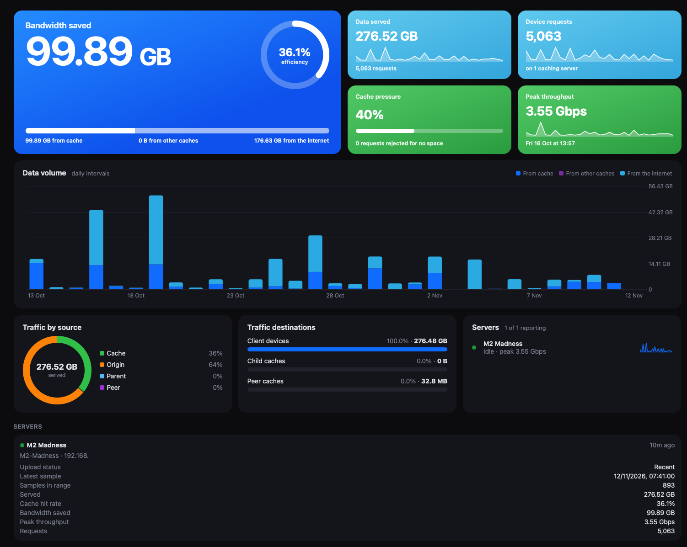

# Content Cache Metrics Classic



This is a monitoring platform for Apples Content Caching that works on Pre macOS 27 or Non DDM managed macOS 27 Content Caching servers.

If you have DDM and macOS27 then look at Content Cache Metrics instead.

## Content Cache Metrics Classic features

| Area | Features |
| --- | --- |
| **Live dashboard** | Refreshes every 15 seconds. Filter by cache server and time range, and choose automatic, hourly, six-hourly, or daily chart intervals. |
| **Cache performance** | Track bandwidth saved, cache hit rate, bytes served and downloaded, peak throughput, requests, cache pressure, and requests rejected due to lack of space. |
| **Traffic breakdowns** | See how much data came from the local cache, other caches, or the internet, and how much went to client devices, child caches, or peer caches. |
| **Server monitoring** | Monitor multiple Macs from one dashboard. See when each server last uploaded, whether its upload is overdue, and how its metrics compare with other servers. |
| **Dashboard customisation** | Change tile and chart colours, drag panels to reorder them within their sections, and reset colours and layout independently. |
| **Settings and themes** | Save preferences in your browser and import or export colours and panel order as JSON. Theme packs include current and classic F1 liveries, ’80s children’s TV, and ’80s action shows. |
| **Data management** | Export metrics as CSV, choose automatic retention of 3, 6, or 12 months or keep data forever, and delete collected data from the dashboard. |
| **Metrics collection** | Use the supplied macOS script for terminal summaries, CSV exports, or direct uploads. The included LaunchDaemon template supports scheduled hourly uploads. Overlapping uploads update existing samples without double-counting. |
| **Server enrolment** | Optionally require an enrolment token for uploads and approve or reject new cache servers from the dashboard. |
| **Deployment and integrations** | Run the Python receiver directly or deploy it with Docker or Docker Compose. Access metrics through the JSON API or scrape them with Prometheus. |

Python 3.9+; no extra packages. Keep server.py and index.html together.

Start the receiver:

```sh
python3 server.py --port 8080 --timezone Europe/London --period 3600
```

Open http://localhost:8080. The dashboard refreshes every 15 seconds. `--period` is the expected interval between CSV uploads, in seconds. An upload becomes overdue after three intervals plus 30 seconds. This indicates upload freshness, not whether Content Caching is active.

Generate a CSV on each cache Mac using the corrected contentcache_metrics.sh, then upload it:

```sh
sudo bash contentcache_metrics.sh --csv > metrics.csv
curl --fail-with-body --request PUT \
  --header 'Content-Type: text/csv' \
  --header "X-Server-ID: $(scutil --get LocalHostName)" \
  --header "X-Hostname: $(scutil --get ComputerName)" \
  --header 'X-Timezone: Europe/London' \
  --data-binary @metrics.csv \
  'http://dashboard-host:8080/api/metrics'
```

Replace `dashboard-host` with the receiver's address. Choose a stable, unique X-Server-ID for each Mac; a serial number or hardware UUID is also suitable. An alternative is `PUT /api/metrics?server=cache-01&timezone=Europe%2FLondon`. PUT to `/` also works.

The CSV must include `timestamp` and all 25 metric columns emitted by the supplied script. Upload the raw CSV, not a multipart form. Maximum upload: 16 MiB. Validation errors return HTTP 400 with a description. A successful upload returns the number of unique timestamp rows and how many were inserted or changed. The whole CSV is validated before saving; invalid uploads leave existing records unchanged. Header-only files are accepted and update upload freshness without adding samples.

Repeated timestamps for the same server replace earlier values; overlapping daily exports do not inflate totals. Within one upload, the last row at a given timestamp wins. Data is stored in ccmon.db alongside the server (override with --db). Samples older than the retention period (default 90 days; 3, 6 or 12 months or forever, selectable from the dashboard) are pruned hourly. Server registrations remain so overdue uploads stay visible.

The dashboard reports totals in the selected range, traffic by source, bytes imported, requests, dropped/purged bytes and maximum cache pressure. Hit rate is cached bytes divided by all served bytes, weighted by traffic. Charts sum traffic and requests in time buckets and take the maximum pressure. Raw CSV does not contain cache capacity, disk use, CPU, connected-client counts or peer health, so those JSON-only displays are omitted. The provided exporter does not include bytesFromPeerToPeer; totals use the fields available in that export.

## Options and defaults

The options below match the supplied `server.py`, `contentcache_metrics.sh`, dashboard and LaunchDaemon template. Example commands elsewhere in this README may override these defaults.

### Receiver: server.py

Run `python3 server.py --help` to see the command-line options.

| Option | Compose variable | Default | Purpose and accepted values |
| --- | --- | --- | --- |
| `--host ADDRESS` | `CCM_HOST` | `0.0.0.0` | Listening address; accepts connections on all IPv4 interfaces by default. Use `127.0.0.1` for local access or a local proxy. |
| `--port NUMBER` | `CCM_PORT` | `8080` | HTTP listening port. For example, `--port 8090`. |
| `--db PATH` | `CCM_DB` | `ccmon.db` beside `server.py` | Receiver's SQLite database. This is separate from the cache Mac's Apple Metrics.db. An explicit relative path is resolved from the directory where you start the receiver; the parent directory must exist. |
| `--timezone NAME` | `CCM_TIMEZONE` | `UTC` | IANA time zone for uploaded timestamps without an explicit offset, unless the upload supplies its own time zone. For example, `Europe/London`. |
| `--period SECONDS` | `CCM_PERIOD` | `3600` (1 hour) | Expected interval between successful uploads; positive whole number. Used only for upload freshness. It does not schedule uploads, control sample frequency or change chart intervals. A server is marked overdue after `3 × period + 30` seconds: **10,830 seconds (3 hours 30 seconds)** by default. |
| `--retention-days DAYS` | `CCM_RETENTION_DAYS` | `90` | Initial retention in days; `0` keeps samples forever. Once you choose a retention from the dashboard (or `PUT /api/settings`), that saved choice is stored in the database and takes precedence over this flag on later starts. Cleanup runs on start and then hourly, so removal is not immediate at the cutoff. Server registrations remain visible after their samples are removed. |
| `--enroll-token TOKEN` | `CCM_ENROLL_TOKEN` | Off (also reads `CCM_ENROLL_TOKEN`) | Require this bearer token on uploads, and hold each new server ID for approval on the dashboard. See “Enrollment and approval”. Prefer the environment variable, which keeps the token out of the process list. |
| `-h`, `--help` | — | Not requested | Print usage and exit without starting the receiver. |

Example with every receiver setting explicitly supplied:

```sh
python3 server.py --host 0.0.0.0 --port 8080 \
  --db /path/to/existing-folder/ccmon.db \
  --timezone UTC --period 3600 --retention-days 90
```

### Cache Mac: contentcache_metrics.sh

Run `bash contentcache_metrics.sh --help` for usage. Reading metrics and uploading require root; help does not.

| Option | Default | Purpose and accepted values |
| --- | --- | --- |
| `--db PATH` | `/Library/Application Support/Apple/AssetCache/Metrics/Metrics.db` | Apple's source metrics database, opened read-only. Quote paths containing spaces. |
| `--hours NUMBER` | `24` | Look back this many hours when generating the summary, CSV or upload. Use a positive number, such as `6` or `24`. |
| `--days NUMBER` | Not set; the default window is 24 hours | Alternative to `--hours`; converted to hours by multiplying by 24. For example, `--days 7` selects 168 hours. If both are supplied, whichever appears last sets the window. |
| `--by hour` or `--by day` | Automatic: `hour` for windows up to 48 hours; `day` for windows greater than 48 hours | Grouping for the terminal summary table only. Does not change the raw CSV or uploaded samples, or the dashboard's chart intervals. Use exactly `hour` or `day`; the current implementation treats any other nonempty value as hourly. |
| `--csv` | Off | Without an upload option, print CSV instead of the terminal summary. With an upload option, also print the uploaded CSV to stdout after a successful upload. CSV always includes column headers, including when no samples match. |
| `--post URL` | Off; no upload URL | Generate CSV and POST it to the full receiver endpoint, for example `http://dashboard-host:8080/api/metrics`. Requires the receiver with POST support. Upload-only output unless `--csv` is also supplied. |
| `--put URL` | Off; no upload URL | Generate CSV and PUT it to the same endpoint. Works with the previous PUT-only CSV receiver as well as the updated receiver. Use only one upload option per invocation. |
| `--server-id ID` | Mac's `LocalHostName`; falls back to `hostname` if lookup fails | Upload identity, sent as `X-Server-ID`. Must be unique and stable for each Mac, 1–200 characters, without line breaks. Matching timestamps are deduplicated within this identity. Used only during upload. |
| `--hostname NAME` | Mac's `ComputerName`; falls back to `hostname` if lookup fails | Display name, sent as `X-Hostname`; at most 200 characters, without line breaks. Quote names containing spaces. Used only during upload. |
| `--token TOKEN` | None (also reads `CONTENTCACHE_TOKEN`) | Enrollment token sent as `Authorization: Bearer`, for receivers started with `--enroll-token`. Letters, digits and `. _ ~ + / = -` only. See “Enrollment and approval”. |
| `-h`, `--help` | Not requested | Print usage and exit. |

With no options, the script prints a last-24-hours summary and hourly terminal table. It does not write a CSV file or upload anything. Use shell redirection to save `--csv` output to a file.

Ordinary CSV output uses the Mac's local time. Uploads always use UTC timestamps and send `X-Timezone: UTC`; there is no script `--timezone` option. The receiver's `--timezone` setting therefore does not change timestamps sent by the script's upload options.

Upload responses and errors go to stderr. With `--csv` and an upload option, stdout contains only the successfully uploaded CSV. Failed uploads and CSV exports return a nonzero exit status. There is no automatic retry in the script. Most repeated value options use their last supplied value; supplying `--post` or `--put` more than once is rejected.

Examples:

```sh
# Summary for the last seven days, grouped by day.
sudo bash contentcache_metrics.sh --days 7 --by day

# Save the last 24 hours as CSV in local time.
sudo bash contentcache_metrics.sh --csv > metrics.csv

# Upload the last six hours with a specific identity and display name.
sudo bash contentcache_metrics.sh --hours 6 \
  --post http://dashboard-host:8080/api/metrics \
  --server-id cache-01 --hostname "Office Cache"

# Upload and save the identical UTC CSV after success.
sudo bash contentcache_metrics.sh --csv \
  --put http://dashboard-host:8080/api/metrics > uploaded-metrics.csv
```

### Dashboard and API settings

| Setting | Default | How to change it |
| --- | --- | --- |
| Dashboard range | `24h` | Range menu: `1h`, `6h`, `24h`, `7d` or `30d`. This selects the display window; it does not change what the uploader sends. |
| Dashboard granularity | `Auto` | Granularity menu: `Auto`, `Hour`, `6 hours` or `Day`. Sets the chart bucket width via `bucket=` (see API reference). |
| Dashboard server selection | `All` | Server menu; choose one server to filter the display. |
| Dashboard refresh | Every 15 seconds | Fixed in `index.html`; no command-line option. Refreshing fetches stored data and does not trigger a cache Mac upload. |
| API `hours` parameter | `24` | `GET /api/dashboard?hours=6`; accepts numbers greater than 0 and at most 8760. |
| API `bucket` parameter | `auto` | `GET /api/dashboard?bucket=hour`; accepts `auto`, `hour` (3600 s), `6h` (21600 s) or `day` (86400 s). |
| API upload `server` parameter | No identity unless `X-Server-ID` is supplied | Set `?server=cache-01` or `X-Server-ID`; a nonempty query value takes precedence. Required for uploads. |
| API upload display name | Server ID | Supply `X-Hostname`. The script normally supplies the Mac's ComputerName instead. |
| API upload time zone | Receiver's `--timezone` (`UTC` by default) | Supply `?timezone=Europe%2FLondon` or `X-Timezone`; a nonempty query value takes precedence. An explicit offset on a timestamp determines that sample's time. |
| Chart interval (“bucket”) | Automatic; no fixed duration | With `bucket=auto`, width is `max(60, int(hours × 3600 / 500))` seconds; the Granularity menu or `bucket` parameter overrides this with a fixed width. For the default 24-hour window it is 172 seconds, displayed as approximately `3m`. Raw stored samples remain unchanged. No command-line override. |

Range, Granularity and Server selections are saved in the current browser and
restored when you reload the dashboard. If the saved server is unavailable, the
dashboard shows all servers until it becomes available again.

#### Customise the dashboard

Use the **Customise** dropdown in the dashboard's top bar to change its appearance or transfer your preferences.

| Option | What it does |
| --- | --- |
| **Dashboard colours** | Pick a theme or change individual colours used by summary tiles, traffic charts and server chart lines. Changes apply immediately. Choose **Reset colours** in the dialog to restore the built-in palette. |
| **Reset panel layout** | Restore the original panel order. |
| **Export settings…** | Download `content-cache-dashboard-settings.json` with your colour overrides and panel order. |
| **Import settings…** | Open an exported settings file to replace your current colours and panel order. |

Drag a summary tile, traffic panel, server card or detailed chart anywhere on its surface and drop it onto another panel in the same section. You can also focus a panel with **Tab** and move it with the arrow keys.

Colours and panel order are saved in the current browser. Use the JSON settings file to transfer them to another browser. To download collected metrics, use **Export CSV** in the **Data** panel.

#### Add themes to the dropdown

To make themes available to dashboard users, create a `themes/` folder next to
`server.py` and copy exported settings JSON files into it. You can put extracted
theme packs in subfolders. Open **Customise → Dashboard colours** and choose a
file from the **Theme** dropdown. Each folder has its own section, with nested
folders shown by their relative path. Files directly in `themes/` appear under
**General**. The list refreshes when you open the dialog.

```text
server.py
themes/
├── office.json
└── TV/
    └── Action/
        ├── airwolf.json
        └── knight-rider.json
```

In this example, **General** contains `office`, and **TV / Action** contains
`airwolf` and `knight rider`.

Applying a theme replaces the current colour overrides and preserves panel
order. Docker Compose mounts `./themes` automatically. With `docker run`, create
the folder and add `--mount "type=bind,src=$PWD/themes,dst=/app/themes,readonly"`.

### Fixed upload limits

These values are implemented in code and are not command-line options.

| Setting | Current value |
| --- | --- |
| Maximum CSV request body | 16 MiB (16,777,216 bytes); empty bodies are rejected, but header-only CSV is accepted. |
| Uploader connection timeout | 10 seconds. |
| Uploader overall request timeout | 120 seconds. |
| Receiver upload socket timeout | 30 seconds while reading the body. |
| Compression and streaming | Uncompressed body with `Content-Length`; chunked uploads are rejected. |
| Authentication and HTTPS | Uploads can require an enrollment token with new servers approved on the dashboard (see “Enrollment and approval”). The dashboard, `/metrics`, export, retention and delete have no authentication, and there is no TLS; configure these on a proxy if required. |

### Included LaunchDaemon template

These are the template's configured values, not additional script flags. Edit the plist and reload the job to change them; installation and reload commands are below in “Hourly uploads with a LaunchDaemon”.

| Setting | Template value | Meaning |
| --- | --- | --- |
| Label | `local.contentcache.metrics` | Job identifier used with launchctl. |
| User | `root` | Allows access to Apple's metrics database. |
| Interpreter | `/bin/bash` | Executes the metrics script. |
| Installed script | `/Library/Scripts/ContentCacheMonitor/contentcache_metrics.sh` | Must match the installed file location. |
| Export window | `--hours 24` | Every run uploads the last 24 hours. |
| Upload method and URL | `--post http://dashboard-host:8080/api/metrics` | **Replace dashboard-host** with your receiver's address. |
| Enrollment token | Not set | Add `--token` and the value to `ProgramArguments` if the receiver uses `--enroll-token`. |
| Server ID / display name | Not explicitly set | Uses the script's automatic Mac names described above. |
| `RunAtLoad` | `true` | Requests an upload when the job is loaded, including at boot. |
| `StartCalendarInterval` | `Minute = 0` | Requests an upload at the start of each hour. This differs from running 3600 seconds after the preceding invocation. |
| `PATH` | `/usr/bin:/bin:/usr/sbin:/sbin` | Locations searched for the script's system tools. |
| Standard output and error | `/var/log/contentcache_metrics.log` | Appends upload replies and errors; no built-in rotation. |
| Immediate retry / keep-alive | Not enabled | After failure, the next scheduled run retries by uploading the last 24 hours again. |

## Time zones

The exporter's timestamps are local times without an offset. Set X-Timezone for each uploader, or use the receiver's --timezone default (UTC unless specified). Use an IANA time-zone name such as Europe/London. ISO timestamps containing an explicit UTC offset are also accepted. During the repeated hour at the end of daylight saving, local timestamps are ambiguous and may collide; use offset-bearing timestamps if that distinction matters. Samples dated in the future are hidden until their timestamp falls in the selected range.

## Enrollment and approval

By default anyone who can reach the receiver can upload. To restrict this, start it with a shared token:

```sh
CCM_ENROLL_TOKEN='choose-a-long-random-string' python3 server.py
```

Give each cache Mac the same token, either with `--token` (or the `CONTENTCACHE_TOKEN` environment variable) in the uploader:

```sh
sudo bash contentcache_metrics.sh --post http://dashboard-host:8080/api/metrics --token 'choose-a-long-random-string'
```

or in the LaunchDaemon plist's `ProgramArguments`. The token may contain letters, digits and `. _ ~ + / = -`. The script passes it to curl through a private stream, so it does not appear in the process list.

How it behaves:

- **Wrong or missing token:** `401`, nothing is stored.
- **First upload from a new server ID, valid token:** the server is recorded as *pending* and its data is **not** ingested; the response is `403` and the uploader exits nonzero with the message in its log. A **Servers awaiting approval** card appears at the top of the dashboard with the ID, name and IP address.
- **Approve:** click Approve. The server's next upload (the uploader resends the last 24 hours each run, so nothing is lost) is ingested normally.
- **Reject:** click Reject. Later uploads from that ID get `403` and are ignored; the entry stays in the card so it can still be approved.
- **Existing servers** in the database stay approved when you turn the token on. Removing `--enroll-token` approves everything again.

API equivalents: `POST /api/approve?server=ID` and `POST /api/reject?server=ID`, each requiring an `X-CCM-Action: 1` header (this makes browsers run a preflight check, so other websites cannot trigger them). `GET /api/dashboard` returns waiting and rejected servers in `pending`.

The token only gates uploads. It is a shared secret: it cannot be revoked for one Mac, there is no verification code, and **anyone who can open the dashboard can approve a server**, as well as change retention or delete data. Keep the dashboard on a trusted network or behind an authenticated proxy, and use HTTPS if the token crosses an untrusted network, since it is sent in clear text over plain HTTP.

## Deployment

The receiver listens on all interfaces by default. It has no built-in authentication or TLS; use it on a trusted network or place it behind an authenticated HTTPS proxy. Bind to localhost with --host 127.0.0.1 when using a local proxy.


### Running with Docker Compose

With Docker running, open the project directory containing `compose.yaml`, `server.py`,
and `index.html`, then run:

```sh
docker compose up -d
docker compose ps
docker compose logs -f ccmon-classic
```

Set the Compose variables listed in the [receiver options table](#receiver-serverpy) in
a `.env` file next to `compose.yaml`. For example:

```dotenv
CCMON_PORT=8081
CCM_HOST=0.0.0.0
CCM_PORT=8080
CCM_DB=/data/ccmon.db
CCM_TIMEZONE=Europe/London
CCM_PERIOD=3600
CCM_RETENTION_DAYS=180
```

`CCMON_PORT` sets the published host port used in dashboard and upload URLs.
`CCM_PORT` sets the receiver port inside the container. Keep `CCM_HOST=0.0.0.0` for
access through the published port, and keep `CCM_DB` under `/data` to persist it in the
named volume. Compose passes these receiver settings as command-line flags.
For enrollment, set `CCM_ENROLL_TOKEN` in the same file and give the uploaders the matching
token as described under [Enrollment and approval](#enrollment-and-approval). Run
`docker compose up -d` after changing these settings.

`docker compose down` stops and removes the container. The named volume keeps the
receiver's SQLite database. `docker compose down -v` also deletes that volume and its data.

### Running with `docker run`

From the directory containing `server.py` and `index.html`, run:

```sh
docker run -d --name ccmon-classic --restart unless-stopped \
  -p 8080:8080 \
  -e CCM_ENROLL_TOKEN \
  --mount "type=bind,source=$(pwd)/server.py,target=/app/server.py,readonly" \
  --mount "type=bind,source=$(pwd)/index.html,target=/app/index.html,readonly" \
  --mount type=volume,source=ccmon-classic-data,target=/data \
  --workdir /app \
  python:3.13-slim python -u server.py --db /data/ccmon.db
```

Export `CCM_ENROLL_TOKEN` in your shell before running the command if you use enrollment.
For other receiver settings, pass the flags from the receiver options table after
`server.py`, such as `--timezone Europe/London --retention-days 180`. If you pass
`--port`, set the second number in `-p 8080:8080` to match.
To change the host port, replace the first number in `-p 8080:8080`. Use
`docker logs -f ccmon-classic` to follow logs, `docker stop ccmon-classic` to stop the
receiver, and `docker start ccmon-classic` to restart it. Removing the container with
`docker rm ccmon-classic` keeps its named volume. To reuse a Compose database with
`docker run`, stop the Compose service and use its project-scoped volume name in the
volume mount.

### Uploading from a cache Mac

Open `http://localhost:8080/` on the Docker host to view the dashboard. On each cache Mac,
run the exporter with the Docker host's reachable name or IP address:

```sh
sudo bash contentcache_metrics.sh --post http://dashboard-host:8080/api/metrics
```

Use your published host port in both URLs. If you enabled enrollment, add `--token` as
shown above, approve the server in the dashboard, then rerun the upload. The exporter
reads Apple's Metrics.db on the cache Mac. The container stores received CSV metrics
in its own SQLite database.

## Upload directly from the metrics script

```sh
sudo bash contentcache_metrics.sh --hours 24 \
  --post http://dashboard-host:8080/api/metrics \
  --server-id cache-01
```

Install the updated server.py and restart the receiver to enable POST. PUT remains supported: use --put instead of --post to work with either receiver version. The URL must include /api/metrics (or use the receiver root /).

The uploader defaults to the Mac's LocalHostName as server ID and ComputerName as display name. Override these with --server-id and --hostname. Keep the same server ID for overlapping uploads. Uploads always use UTC timestamps with an X-Timezone: UTC header, avoiding local time ambiguity at daylight saving changes. Ordinary --csv output without an upload remains local time.

With --post or --put the default is upload only. Add --csv to also print the uploaded CSV to stdout; receiver replies and upload errors go to stderr. A failed export or upload exits nonzero. Uploads have a 10-second connection timeout and a 120-second overall timeout.

## API reference

All paths are relative to the receiver, for example `http://dashboard-host:8080`. API responses use JSON. No API key or authentication is built in.

| Method | Path | Purpose |
| --- | --- | --- |
| `POST` | `/api/metrics` | Upload a raw CSV export. Requires the updated receiver. |
| `PUT` | `/api/metrics` | Upload the same CSV format; equivalent to POST. |
| `GET` | `/api/dashboard?hours=24` | Retrieve server details, totals and bucketed history as JSON. |
| `GET` | `/api/themes` | List available themes with their names, relative folders and colour overrides. |
| `POST` | `/api/approve?server=ID`, `/api/reject?server=ID` | Approve or reject a pending server (needs `X-CCM-Action: 1`). |
| `GET` | `/api/export.csv` | Download stored samples as CSV; see “Export, retention and deletion”. |
| `GET` / `PUT` | `/api/settings` | Read or change retention. |
| `DELETE` | `/api/data?confirm=delete-all` | Delete all samples and server registrations. |
| `GET` | `/metrics?hours=1` | Prometheus text-format gauges; see “Prometheus metrics”. |
| `GET` | `/` or `/index.html` | View the HTML dashboard. |

POST and PUT also accept `/` as an upload path. The old JSON report endpoints (`/api/servers`, `/api/history`, `/api/errors`, `/api/health` and `/api/raw`) are not available in this CSV version. Existing JSON reports are not returned by the CSV API.

### Upload CSV

```sh
curl --fail-with-body --request POST \
  --header 'Content-Type: text/csv' \
  --header 'X-Server-ID: cache-01' \
  --header 'X-Hostname: Office Cache' \
  --header 'X-Timezone: Europe/London' \
  --data-binary @metrics.csv \
  'http://dashboard-host:8080/api/metrics'
```

Use `X-Timezone: UTC` when uploading a CSV produced by the script's `--post` or `--put` options. The example above assumes an ordinary `--csv` export generated in Europe/London.

| Header or query parameter | Required | Meaning |
| --- | --- | --- |
| `X-Server-ID` or `?server=cache-01` | Yes | Stable server identity, 1–200 characters. The query parameter takes precedence. |
| `X-Hostname` | No | Display name, at most 200 characters; defaults to the server ID. |
| `X-Timezone` or `?timezone=Europe%2FLondon` | No | IANA time zone for timestamps without an offset; defaults to the receiver's `--timezone`. The query parameter takes precedence. |
| `Content-Type: text/csv` | Recommended | Send the CSV as the raw request body. |
| `Content-Length` | Yes | Request size in bytes; curl sets this for `--data-binary @metrics.csv`. Chunked uploads are not supported. |

Upload uncompressed UTF-8 CSV, up to 16 MiB. A UTF-8 byte-order mark is accepted. The first row must contain `timestamp` and all 25 metric column names from the exporter. POST and PUT use the same validation and duplicate handling.

Example successful response (`200 OK`):

```json
{"ok": true, "server": "cache-01", "rows": 120, "changed": 120}
```

`rows` counts unique timestamps in this upload. `changed` counts inserted or updated samples; an identical repeat upload returns `changed: 0`. Header-only CSV returns zero for both and still updates upload freshness.

### Read dashboard data

```sh
curl --fail-with-body 'http://dashboard-host:8080/api/dashboard?hours=24'
```

`hours` defaults to 24 and accepts numbers greater than 0 and at most 8760. `bucket` defaults to `auto` and also accepts `hour`, `6h` or `day`; anything else returns `400`. The API returns all registered servers; there is no server filter parameter. Filter the returned `servers` and `history` arrays by `guid` in your client.

The response contains:

- `servers`: server records with `guid`, `hostname`, `received`, `source_ip`, `timezone`, `age`, `online`, `latest` and `totals`. `received` and `latest` are Unix timestamps in seconds; `latest` is null if there are no samples. `age` is seconds since the last successful upload. `online` indicates upload freshness, not cache service health. `totals` is empty when the server has no samples in the selected range.
- `history`: records with `guid`, bucket start `t` (Unix seconds), `samples` and the aggregated metrics listed below. History includes samples from the selected range up to the current time.
- `bucket`: history bucket width in seconds: `max(60, int(hours * 3600 / 500))` for `auto`, otherwise 3600, 21600 or 86400. Buckets align to Unix epoch boundaries, so the first bucket start may precede the selected range even though its samples are within the range.

Both `totals` and history records contain `served`, `cache`, `origin`, `parent`, `peer`, `downloaded`, `uploaded`, `dropped`, `purged`, `clients`, `children`, `peers`, `saved`, `peak`, `requests`, `rejected`, `pressure` and `samples` when samples exist. Traffic fields are byte counts; `clients`, `children` and `peers` are bytes served to client devices, child caches and peer caches (not counts). `saved` is bytes served minus bytes downloaded from origin, parent and peers, which equals bytes served from cache. `peak` is the highest per-sample throughput in bytes per second (bytes served ÷ the sample's `period`); shown in bits per second on the dashboard. `uploaded` is bytes imported via HTTP and XPC. `requests`, `rejected` and `samples` are counts. `pressure` and `peak` take the maximum across samples (pressure is 0, 20, 40, 60, 80 or 100); other metrics are summed. Calculate cache hit rate as `100 * cache / served` when `served` is greater than zero.

### Export, retention and deletion

**Export.** `GET /api/export.csv` returns stored samples as CSV with a `server` column, an ISO UTC `timestamp` and the 25 metric columns. Optional filters: `?hours=24` (same limits as the dashboard) and `?server=cache-01`. Without `hours` everything stored is exported. The dashboard's **Export CSV** link uses the selected range and server. The file can be re-uploaded: the extra `server` column is ignored, so supply the destination with `?server=ID`.

```sh
curl -o cache-01.csv 'http://dashboard-host:8080/api/export.csv?server=cache-01&hours=720'
```

**Retention.** Choose 3 months, 6 months, 12 months or forever from the dashboard's Data card, or:

```sh
curl --request PUT --header 'Content-Type: application/json' \
  --data '{"retention_days": 365}' http://dashboard-host:8080/api/settings
```

Accepted values are `90`, `180`, `365` and `0` (or `"forever"`). The choice is saved in the database, survives restarts and prunes immediately when lowered. `GET /api/settings` returns the current value.

**Delete everything.** `DELETE /api/data?confirm=delete-all` removes all samples **and** server registrations (the dashboard asks for confirmation first). It returns `{"ok": true, "deleted_rows": N, "deleted_servers": M}`. Servers reappear on their next upload.

```sh
curl --request DELETE 'http://dashboard-host:8080/api/data?confirm=delete-all'
```

The receiver has no authentication, so **anyone who can reach it can change retention or delete all data**. Restrict access with a firewall or an authenticated proxy (see Deployment) before exposing it beyond a trusted network.

### Prometheus metrics

```sh
curl 'http://dashboard-host:8080/metrics?hours=1'
```

Each server is exported with `server` (its ID) and `hostname` labels. `hours` sets the trailing window (default 1; same limits as the dashboard API). Values are **gauges over that window, not monotonic counters**, because old rows are pruned and a counter would appear to go backwards. In PromQL use the value directly or `max_over_time`, not `rate()`.

| Metric | Meaning |
| --- | --- |
| `ccm_server_up` | 1 if the server uploaded within three periods (see `--period`), else 0. |
| `ccm_last_upload_timestamp_seconds`, `ccm_last_sample_timestamp_seconds` | Unix time of the last upload and newest sample. |
| `ccm_samples` | Samples in the window. |
| `ccm_served_bytes`, `ccm_cache_bytes`, `ccm_origin_bytes`, `ccm_parent_bytes`, `ccm_peer_bytes` | Bytes served in total and by source. |
| `ccm_downloaded_bytes`, `ccm_saved_bytes` | Bytes fetched upstream and bandwidth saved. |
| `ccm_clients_bytes`, `ccm_children_bytes`, `ccm_peers_bytes` | Bytes served by destination. |
| `ccm_uploaded_bytes`, `ccm_dropped_bytes`, `ccm_purged_bytes` | Imported, dropped and purged bytes. |
| `ccm_requests`, `ccm_rejected_requests` | Requests, and those rejected for no space. |
| `ccm_peak_throughput_bytes_per_second` | Highest per-sample throughput in the window. |
| `ccm_cache_pressure_percent` | Maximum cache pressure in the window. |

Example scrape configuration:

```yaml
scrape_configs:
  - job_name: contentcache
    metrics_path: /metrics
    params:
      hours: ['1']
    scrape_interval: 5m
    static_configs:
      - targets: ['dashboard-host:8080']
```

Example alert rules:

```yaml
groups:
  - name: contentcache
    rules:
      - alert: ContentCacheNotReporting
        expr: ccm_server_up == 0
        for: 10m
      - alert: ContentCacheFull
        expr: ccm_cache_pressure_percent >= 80 or ccm_rejected_requests > 0
        for: 15m
```

Like the rest of the receiver, `/metrics` has no authentication; restrict access at a proxy or firewall if required.

### Error responses

Errors use a JSON body such as `{"error": "Missing CSV columns: timestamp"}`.

| Status | Meaning |
| --- | --- |
| `400` | Invalid CSV, identity, time zone, hours or bucket parameter, retention value, missing delete confirmation, or upload framing. |
| `404` | Unknown path, including the old JSON endpoints. |
| `413` | Upload body is empty or exceeds 16 MiB. |
| `401` | Upload without a valid enrollment token (when `--enroll-token` is set). |
| `403` | Upload from a server that is pending approval or rejected. |
| `415` | Compressed uploads are not supported; send uncompressed CSV. |
| `500` | An unexpected server-side upload error occurred. |

## Hourly uploads with a LaunchDaemon

Install this on each **cache Mac**. The daemon runs as root, uploads once when loaded (including at boot), then at minute 00 of every hour. It runs without a user logged in. It sends the last 24 hours on each run so a later upload can recover samples after a missed upload; the receiver deduplicates overlapping data. Gaps longer than 24 hours require a manual export with a longer `--hours` or `--days` window.

### 1. Configure the server address

The included `local.contentcache.metrics.plist` contains:

```xml
<?xml version="1.0" encoding="UTF-8"?>
<!DOCTYPE plist PUBLIC "-//Apple//DTD PLIST 1.0//EN" "http://www.apple.com/DTDs/PropertyList-1.0.dtd">
<plist version="1.0">
<dict>
	<key>Label</key>
	<string>local.contentcache.metrics</string>
	<key>ProgramArguments</key>
	<array>
		<string>/bin/bash</string>
		<string>/Library/Scripts/ContentCacheMonitor/contentcache_metrics.sh</string>
		<string>--hours</string>
		<string>24</string>
		<string>--post</string>
		<string>http://dashboard-host:8080/api/metrics</string>
	</array>
	<key>UserName</key>
	<string>root</string>
	<key>RunAtLoad</key>
	<true/>
	<key>StartCalendarInterval</key>
	<dict>
		<key>Minute</key>
		<integer>0</integer>
	</dict>
	<key>EnvironmentVariables</key>
	<dict>
		<key>PATH</key>
		<string>/usr/bin:/bin:/usr/sbin:/sbin</string>
	</dict>
	<key>StandardOutPath</key>
	<string>/var/log/contentcache_metrics.log</string>
	<key>StandardErrorPath</key>
	<string>/var/log/contentcache_metrics.log</string>
</dict>
</plist>
```

Replace `http://dashboard-host:8080/api/metrics` in that file with your receiver's full URL before installing it. POST needs the updated receiver. To use the previous receiver, replace `--post` with `--put`.

The script automatically uses each Mac's LocalHostName as its server ID and ComputerName as its display name. Ensure LocalHostName is unique and stable across your Macs. To set an explicit ID, append these elements inside `ProgramArguments`, using a different ID on each Mac:

```xml
<string>--server-id</string>
<string>cache-01</string>
```

Each argument is a separate XML string. Shell expressions such as `$(hostname)` are not expanded in a plist. Escape `&` as `&amp;` if your URL contains query parameters. Leave out `--csv` so the log contains upload replies rather than every CSV sample.

### 2. Install and load

In Terminal, change to the downloaded folder containing the script and configured plist, then run:

```sh
sudo install -d -o root -g wheel -m 755 /Library/Scripts/ContentCacheMonitor
sudo install -o root -g wheel -m 755 contentcache_metrics.sh \
  /Library/Scripts/ContentCacheMonitor/contentcache_metrics.sh
sudo install -o root -g wheel -m 644 local.contentcache.metrics.plist \
  /Library/LaunchDaemons/local.contentcache.metrics.plist
sudo touch /var/log/contentcache_metrics.log
sudo chown root:wheel /var/log/contentcache_metrics.log
sudo chmod 640 /var/log/contentcache_metrics.log
sudo plutil -lint /Library/LaunchDaemons/local.contentcache.metrics.plist
sudo launchctl bootstrap system /Library/LaunchDaemons/local.contentcache.metrics.plist
```

Bootstrap triggers the first upload because `RunAtLoad` is enabled. The receiver should be running and reachable. Configure it with `--period 3600` to match hourly uploads (this is the default).

### 3. Test and inspect

To request another upload immediately:

```sh
sudo launchctl kickstart system/local.contentcache.metrics
```

Inspect the job and upload log:

```sh
sudo launchctl print system/local.contentcache.metrics
sudo tail -n 50 /var/log/contentcache_metrics.log
```

A successful upload logs a JSON reply containing `"ok": true`. An unchanged repeat may show `"changed": 0`; that is normal. In launchctl output, a last exit code of `0` indicates success. The job normally exits between uploads, so an idle/not-running state is expected. Confirm the server appears in the dashboard.

For failures, check the log, server URL and network access. The script returns a nonzero status if CSV generation or upload fails. There is no immediate automatic retry; the next hourly upload sends the last 24 hours again. A failed boot-time upload can therefore recover on a later run. The log is appended to; arrange log rotation for long-term use.

### 4. Update or remove

After editing the installed plist, reload it:

```sh
sudo launchctl bootout system/local.contentcache.metrics
sudo plutil -lint /Library/LaunchDaemons/local.contentcache.metrics.plist
sudo launchctl bootstrap system /Library/LaunchDaemons/local.contentcache.metrics.plist
```

If only the installed script changes, the next invocation uses the new file; no plist reload is required. Keep the script owned by root and not writable by other users.

To stop hourly uploads and remove the job:

```sh
sudo launchctl bootout system/local.contentcache.metrics
sudo rm /Library/LaunchDaemons/local.contentcache.metrics.plist
```

This leaves the script, log and receiver's saved data in place.

`StartCalendarInterval` is a calendar schedule: if the Mac sleeps through a scheduled time, launchd runs the job after wake. It does not wake or power on the Mac itself. See Apple's [Scheduling Timed Jobs](https://developer.apple.com/library/archive/documentation/MacOSX/Conceptual/BPSystemStartup/Chapters/ScheduledJobs.html) and [Creating Launch Daemons and Agents](https://developer.apple.com/library/archive/documentation/MacOSX/Conceptual/BPSystemStartup/Chapters/CreatingLaunchdJobs.html) for scheduling and installation details.
